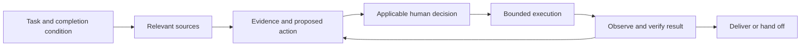

# Product workspace operating model

Workspace model v2 is a general-purpose way for a product manager and an agent to carry work from a question to a reviewable result. It supports technical and nontechnical work. Code access is useful when implementation is the question, not a prerequisite for every product task.

## Start from the decision

State the task, intended reader and observable completion condition. The agent selects the relevant workspace route, sources and existing task handoff. With no focus, it asks for the task instead of inventorying repositories. A small known-file change needs only its applicable instructions and context.

Keep stable rules in a short native instruction file. Keep source navigation in WORKSPACE.md, detailed procedures in selected skills, changing facts in maintained source records and task continuity in an existing working document. Loading a large history into every session makes historical assumptions easier to mistake for current facts.

## Sources answer different questions

| Question | Relevant authority | Limit |
| --- | --- | --- |
| What is requested? | Original request and accountable owner | A request is not automatically an accepted commitment |
| What do we intend or accept? | Approved brief, contract or decision | Proposed goals are not approved requirements |
| What is implemented? | Inspected source, contracts and tests | Code does not prove deployment or universal availability |
| What is enabled and used? | Release/configuration and runtime evidence | One population or platform does not establish another |
| What impact was measured? | Primary data with cohort, window, metric definitions and analysis | Reach, activity or correlation alone does not establish causal business impact |
| What should happen next? | Human decision informed by evidence and trade-offs | Agent inference does not confer ownership or approval |

Record source versions and material dates. Keep unknowns visible. Empty search results and missing events are prompts for investigation, not proof that support is absent. A passing test and a closed tracker item answer narrower questions than “delivered and effective”.

## Scope and delivery

Enduring workstreams describe the systems or outcomes a team maintains and evolves. Cycle priorities and initiatives sponsor selected work. Keep them related without forcing each workstream to fit one funding home.

Use one underlying record for each independently reviewable deliverable, with links to all relevant requests, jobs and completion criteria. A request can change several jobs; several initiatives can benefit from the same implementation. Keep the shared estimate once. Show current and proposed job definitions in readable language, with IDs as supporting traceability.

Separate new scope, confirmed continuation, possible rollover, routine support, discovery and adjacent-team work. An agreement to collaborate does not necessarily require custom development. Historical cancellation can describe a tracking decision without proving that the underlying capability was dropped.

The simplest adequate source may be a spreadsheet or document. Use a structured register when stable identities, joins or derived views genuinely need it. A source-of-truth rule is about who maintains a fact, not about choosing a particular database.

## Execute and verify

Follow the target environment's authorization rules. Reading, drafting, external writes, publication, pushes, merges and releases can require different approvals. Preserve approvals already granted for the exact work. Discovering a linked source does not authorize changing its repository. Prepare the complete diff and any required contribution record together before an exact-diff checkpoint; a plan approval does not approve a later diff. Complete authorized preparation before asking the user to approve a concrete next action.

Verify the thing the reader will use: changed behavior, complete table placement, clickable links, filter/sort semantics or actual layout as appropriate. Broaden verification only for a concrete risk or required gate. Tool success responses and row counts alone are insufficient.

An agreed review handoff can be a valid completion condition. Label unresolved owner decisions, rollout checks or candidate gaps explicitly. Do not invent certainty or keep researching indefinitely to avoid finishing the agreed stage.

## Keep artifacts understandable

Each fact has a maintained home; other artifacts link to it or derive a dated view. Update the source before its projections. Preserve reviewer edits. A live workbook and generated web page cannot both silently own scope decisions.

Use readable titles and content before IDs, explicit status values alongside colors, and useful link labels. Group related work without merging independently reviewable outcomes. When consolidating, keep original meaning and provenance; shortening text should not remove conditions, exclusions or acceptance detail.

## Continue across sessions

For substantial work, maintain a short handoff in the existing task document: goal/completion condition, accepted decisions and provenance, branch/review, source dates, unresolved questions and next action. Link evidence instead of copying conversations. This is context, not a new permission grant.

On resume, recover that state, verify mutable sources and proceed with the next approved action. Start a new session in the appropriate repository when native instruction discovery matters. A change of directory inside an existing session does not necessarily reload its original instructions.

## Local configuration and distribution

The framework ships methods and fictional examples. Supply private repositories, accounts, connector settings, data and conversations in the target environment. A folder named sandbox is not an access control. A clean pattern check is not a disclosure clearance.

The local initializer previews its file plan, refuses existing differences and installs a small selected skill set. It does not configure connectors, install hooks, edit global instructions, initialize a remote, start services or call a model. See [getting started](../../getting-started.md), [migration](workspace-migration.md) and [skill distribution](skill-distribution.md).
